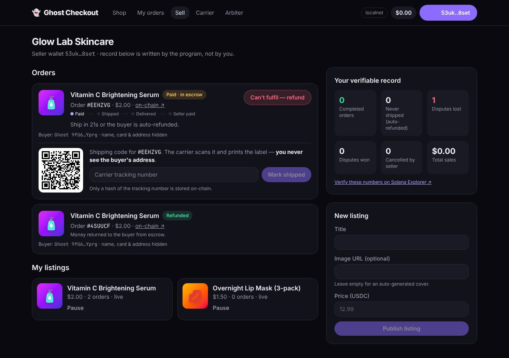
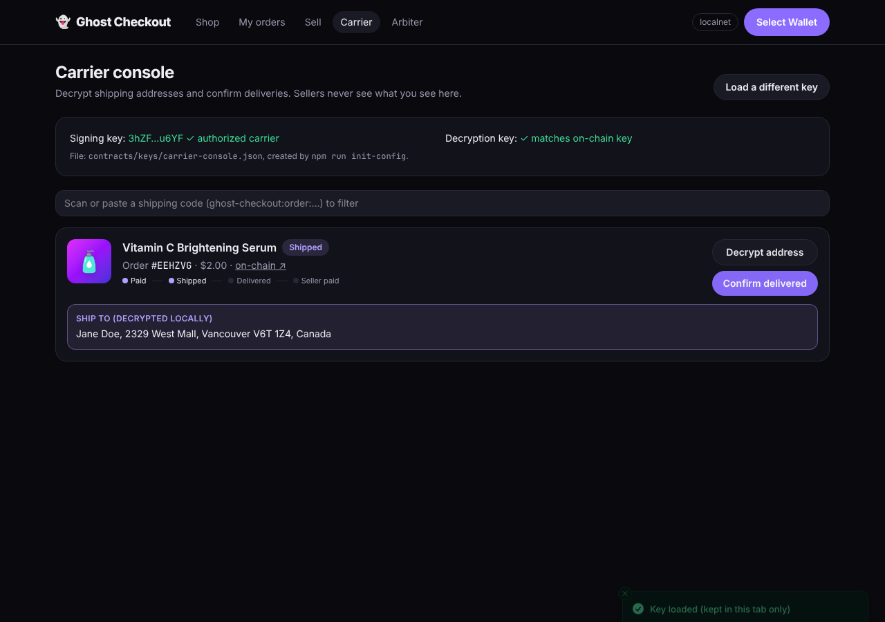

# 👻 Ghost Checkout

**Buy from anyone in your feed. Reveal nothing.**

Ghost Checkout is a private, escrowed checkout for social commerce (TikTok Shop / Temu-style impulse buys), settled in **USDC on Solana**.

| The problem today | Ghost Checkout |
|---|---|
| Sellers who ship themselves need your name, address and phone, and scammers phish for more | The seller sees **`Order #4SUUCF`** and an encrypted blob. Your address is encrypted in your browser so **only the shipping carrier** can read it. |
| You pay up front and hope. Refunds depend on the platform's support queue | USDC sits in an **on-chain escrow**. The seller is paid only after the carrier confirms delivery and your inspection window passes. If they don't ship in time, **anyone can trigger your refund**, with no claim form. |
| Reviews can be bought, and bad ones can be removed | Seller ratings are **counters written by the escrow program** when money moves (completed, never shipped, disputes lost/won). Nobody can fake, buy or delete them, and anyone can check them on Solana Explorer. |

| Private checkout | Seller sees no buyer info | Only the carrier can decrypt |
|---|---|---|
|  |  |  |

Track: **Consumer Applications** (the crypto stays invisible: no seed phrases, no gas talk, just "Pay $2.00 privately").

---

## How it works

```
 Buyer (browser)                 Solana program (escrow)                 Seller            Carrier
 ───────────────                 ───────────────────────                 ──────            ───────
 address ──encrypt to carrier key──► place_order: USDC → vault PDA
                                     status = Paid, ship deadline set ──► sees Order #code
                                                                          + QR shipping code
                                     mark_shipped ◄──────────────────────  (tracking hash)
                                     confirm_delivery ◄──────────────────────────────────────── decrypts address,
                                     status = Delivered, inspection window starts               delivers parcel
 "Looks good" / wait ──────────────► release_payment: vault → seller, seller.completed += 1
 "It's fake!" ─────────────────────► open_dispute → arbiter resolve_dispute (refund or pay)
 seller never ships ───────────────► refund_unshipped (anyone, after deadline), seller.refunded += 1
```

**Why this needs a blockchain**
1. **Escrow no one controls.** The USDC vault is owned by a PDA, so only the program's rules can move it. That includes the platform: it can't freeze or redirect funds.
2. **Reputation no one can edit.** Seller stats are only changed by order outcomes inside the program.
3. **Refunds no one can block.** `refund_unshipped` is permissionless once the deadline passes.
4. **Privacy by construction.** The chain only ever holds ciphertext of the address, plus a hash of the tracking number.

**Fake orders are expensive.** A seller can't pad their record with self-purchases from the same wallet (blocked on-chain). Using a second wallet still requires a **real parcel the carrier scans as delivered** before an order counts.

**Trust assumptions (stated plainly):** the *carrier* is trusted to attest delivery honestly, and the *arbiter* (config admin) is trusted to rule on disputes. Both are single keys in this version. Every decision they make is public and permanent, and both can be rotated with `update_config`. A production version would use a carrier oracle network and a multisig or DAO arbiter.

---

## Repository layout

```
ubc/
├── contracts/                      Anchor workspace (Solana program)
│   ├── Anchor.toml
│   ├── programs/ghost_checkout/src/
│   │   ├── lib.rs                  program entry: 13 instructions
│   │   ├── state.rs                Config, Seller, Listing, Order accounts + PDA seeds
│   │   ├── errors.rs               custom error codes
│   │   ├── events.rs               events emitted on every state change
│   │   └── instructions/
│   │       ├── config.rs           initialize_config, update_config
│   │       ├── seller.rs           register_seller, create_listing, set_listing_active
│   │       ├── order.rs            place_order, mark_shipped, cancel_order, refund_unshipped
│   │       ├── delivery.rs         confirm_delivery, release_payment, open_dispute, resolve_dispute
│   │       └── escrow.rs           shared vault payout helper (PDA-signed transfer + close)
│   ├── tests/ghost_checkout.ts     29 tests: happy paths, edge cases, unauthorized access
│   └── scripts/
│       ├── init-config.ts          post-deploy setup (carrier keys, config, prints .env values)
│       ├── seed-demo.ts            demo sellers + listings (real on-chain txs)
│       ├── faucet.ts               local-only test USDC faucet
│       └── export-idl.ts           copies IDL + types into the frontend
└── frontend/                       Next.js 15 (App Router) + TypeScript + Tailwind v4
    ├── .env.example
    └── src/
        ├── idl/                    generated IDL + TS types (from export-idl)
        ├── lib/
        │   ├── contracts.ts        typed config: program ID, RPC, cluster, explorer links
        │   ├── actions.ts          every instruction call, with its accounts
        │   ├── crypto.ts           address sealing (NaCl box) + tracking hash
        │   ├── hooks.ts            live data hooks (poll the chain every 8s)
        │   ├── pda.ts              PDA seeds (mirror state.rs)
        │   ├── program.ts          Anchor client for wallet or key-file signers
        │   └── tx.ts               toast notifications + readable errors
        ├── components/             UI building blocks (checkout modal, order card, trust stats…)
        └── app/
            ├── page.tsx            Shop feed
            ├── orders/             Buyer dashboard
            ├── sell/               Seller dashboard
            ├── carrier/            Carrier console (decrypt + confirm delivery)
            ├── arbiter/            Dispute resolution
            └── seller/[authority]/ Public seller record
```

---

## Prerequisites

| Tool | Version used | Install |
|---|---|---|
| Rust | 1.97 | https://rustup.rs |
| Solana CLI (Agave) | 4.4.1 | https://solana.com/docs/intro/installation |
| Anchor CLI | 0.32.1 | `cargo install anchor-cli --version 0.32.1 --locked` (Linux needs `libudev-dev pkg-config`) |
| Node.js | 22 | https://nodejs.org |

No WalletConnect key is needed: Phantom, Solflare and Backpack are auto-detected through the Wallet Standard.

## Setup

```bash
git clone https://github.com/AVcool3/UBC.git && cd UBC
```

```bash
cd contracts && npm install
```

```bash
anchor keys sync && anchor build && npm run export-idl
```

`anchor keys sync` points `declare_id!` and `Anchor.toml` at *your* program keypair. Run it once after cloning.

```bash
cd ../frontend && npm install && cp .env.example .env.local
```

---

## Verification checklist

### 1. Run the tests (local validator)

```bash
cd contracts && anchor test
```

Expected: **29 passing** (≈30s; a few tests wait out real deadlines).

### 2. Try the full app locally (no faucets needed)

Terminal 1, a local chain with the program loaded:

```bash
cd contracts && solana-test-validator --reset --bpf-program $(solana address -k target/deploy/ghost_checkout-keypair.json) target/deploy/ghost_checkout.so
```

Terminal 2, setup plus demo data (short windows make the demo snappy):

```bash
cd contracts && export ANCHOR_PROVIDER_URL=http://127.0.0.1:8899
```

```bash
SHIP_WINDOW_SECS=120 INSPECTION_WINDOW_SECS=60 npm run init-config && npm run seed-demo
```

```bash
npx tsx scripts/faucet.ts <YOUR_PHANTOM_ADDRESS> 50
```

Point Phantom at localhost (Settings → Developer settings → Solana localnet), then:

```bash
cd ../frontend && printf "NEXT_PUBLIC_SOLANA_RPC_URL=http://127.0.0.1:8899\nNEXT_PUBLIC_SOLANA_CLUSTER=localnet\n" > .env.local && npm run dev
```

Open http://localhost:3000.

### 3. Deploy to devnet

The program is ~388 KB. Deploying needs ~2.7 SOL of rent plus a temporary buffer of similar size, so have **~6 devnet SOL**. Get it from https://faucet.solana.com or `solana airdrop 2` (repeat).

```bash
solana config set --url devnet && solana balance
```

```bash
cd contracts && anchor deploy --provider.cluster devnet
```

```bash
npm run init-config
```

Optional: publish the IDL on-chain so Explorer can decode your transactions.

```bash
anchor idl init --provider.cluster devnet --filepath target/idl/ghost_checkout.json $(solana address -k target/deploy/ghost_checkout-keypair.json)
```

Optional: verifiable build (needs Docker), so anyone can check the deployed bytecode matches this repo.

```bash
anchor build --verifiable
```

`init-config` prints the three `NEXT_PUBLIC_*` values. Paste them into `frontend/.env.local`, then:

```bash
npm run seed-demo
```

```bash
cd ../frontend && npm run build && npm start
```

Get devnet USDC for your buyer wallet at **https://faucet.circle.com** (choose Solana Devnet). Demo prices are $1–$3 so one faucet drip covers several orders.

### 4. Click through every role

| Role | How to sign in | What to check |
|---|---|---|
| Buyer | Your Phantom wallet | Shop → **Buy privately**. The right panel shows what the seller sees (ciphertext only). |
| Seller | Import `contracts/keys/seller-glow.json` into Phantom (Add account → Import private key), or register any wallet on **Sell** | Order shows `Ghost 9fU6…` + QR code, never a name/address. Enter a tracking number → **Mark shipped**. |
| Carrier | **Carrier** page → load `contracts/keys/carrier-console.json` | **Decrypt address** shows the real address (only here). **Confirm delivered**. |
| Buyer | **My orders** | **Looks good — pay seller**, or **Fake / broken? Report**. |
| Arbiter | **Arbiter** page → connect the admin wallet or load `~/.config/solana/id.json` | **Refund buyer** / **Pay seller**. The seller's public record updates. |
| Anyone | Buy from *FlashDeals99* and don't ship | After the ship window, **Get my refund** appears. The seller's card turns ⚠ in the feed. |

Every toast has an **Explorer ↗** link, and every seller page links to its on-chain record.

---

## 2–3 minute demo script

1. **(0:00) Hook.** "Buying from a TikTok Shop seller means handing a stranger your name, address and card, and trusting reviews anyone can buy."
2. **(0:20) Shop.** Show the feed and trust chips ("built only from real orders").
3. **(0:40) Checkout.** Type an address and point at *What the seller sees*: the ciphertext updating live. Pay $2.00.
4. **(1:05) Seller view.** `Ghost 9fU6…`, a QR code, no address. Mark shipped.
5. **(1:25) Carrier view.** Decrypt (the only place the address exists in plain text), then confirm delivered.
6. **(1:45) Protection.** Report the item as fake → arbiter refunds. Then show FlashDeals99, which never shipped: the buyer got an automatic refund, and the seller's public record now shows it permanently.
7. **(2:15) Proof.** Open the seller's account on Solana Explorer: "these numbers are written by the escrow program; nobody can edit them."
8. **(2:35) Close.** "Ghost Checkout: buy from anyone, reveal nothing, pay only on delivery."

---

## Security notes

- **Checks → effects → interactions:** every payout updates order status and seller counters *before* the token CPI. Solana also forbids re-entrancy into a program through CPI.
- **Custom errors** for every rule (`errors.rs`), and **events** on every state change (`events.rs`), carrying all relevant pubkeys for indexing.
- **All math is checked** (`checked_add`), and `overflow-checks = true` in release.
- **Account validation** is done by Anchor constraints: PDA seeds, `has_one`, mint/authority checks on every token account, and an `address = config.usdc_mint` pin.
- **Vaults are closed** after payout, and their rent returns to the buyer.
- Not audited. It's a hackathon build, so don't use it with real funds yet.

## Built during the hackathon

All code in this repository was written during the hackathon (Nov 2026).
