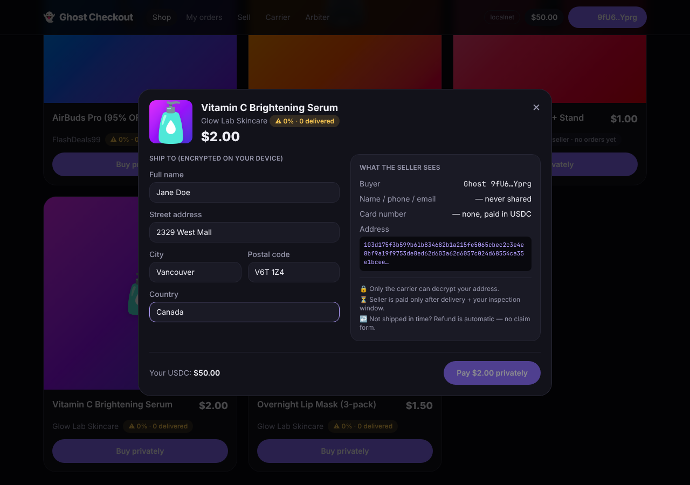

# 👻 Ghost Checkout

**Buy from anyone in your feed. Reveal nothing.**

Ghost Checkout is a private, escrowed checkout for social commerce (TikTok Shop / Temu-style impulse buys), settled in **USDC on Solana**.

| The problem today | Ghost Checkout |
|---|---|
| Sellers who ship themselves need your name, address and phone, and scammers phish for more | The seller sees **`Order #4SUUCF`** and an encrypted blob. Your address is encrypted in your browser so **only the shipping carrier** can read it. |
| You pay up front and hope. Refunds depend on the platform's support queue | USDC sits in an **on-chain escrow**. The seller is paid only after the carrier confirms delivery and your inspection window passes. If they don't ship in time, **anyone can trigger your refund**, with no claim form. |
| Reviews can be bought, and bad ones can be removed | Seller ratings are **counters written by the escrow program** when money moves (completed, never shipped, disputes lost/won). Nobody can fake, buy or delete them, and anyone can check them on Solana Explorer. |

| Private checkout | Seller sees no buyer info | Only the carrier can decrypt |
|---|---|---|
|  |  |  |

### UBC 2026 Hackathon submission

| | |
|---|---|
| **Main track** | Consumer Applications |
| **Chain award** | Best use of Solana |
| **Program ID (Solana devnet)** | [`9TBWXeFennM42nASPhYY78vbNGiMQK252csS9TdgKxdD`](https://explorer.solana.com/address/9TBWXeFennM42nASPhYY78vbNGiMQK252csS9TdgKxdD?cluster=devnet) |
| **Try it** | Open the live app and click **Create demo account → Get $20 test money**. No wallet app, seed phrase or crypto needed (see [Demo mode](#5-demo-mode-try-it-alone-in-a-minute)). |
| **Buy from a post** | Every product is a **Solana Blink**: click **Share ⚡** on any card and open the Blink to buy straight from a social post (see [Blinks](#buy-from-a-post-solana-blinks)). |

The crypto stays invisible: no seed phrases, no gas, just "Pay $2.00 privately".

---

## How it works

```
 Buyer (browser)                 Solana program (escrow)                 Seller            Carrier
 ───────────────                 ───────────────────────                 ──────            ───────
 address ──encrypt to carrier key──► place_order: USDC → vault PDA
                                     status = Paid, ship deadline set ──► sees Order #code
                                                                          + QR shipping code
                                     mark_shipped ◄──────────────────────  (tracking hash)
                                     confirm_delivery ◄──────────────────────────────────────── decrypts address,
                                     status = Delivered, inspection window starts               delivers parcel
 "Looks good" / wait ──────────────► release_payment: vault → seller, seller.completed += 1
 "It's fake!" ─────────────────────► open_dispute → arbiter resolve_dispute (refund or pay)
 seller never ships ───────────────► refund_unshipped (anyone, after deadline), seller.refunded += 1
```

**Why this needs a blockchain**
1. **Escrow no one controls.** The USDC vault is owned by a PDA, so only the program's rules can move it. That includes the platform: it can't freeze or redirect funds.
2. **Reputation no one can edit.** Seller stats are only changed by order outcomes inside the program.
3. **Refunds no one can block.** `refund_unshipped` is permissionless once the deadline passes.
4. **Privacy by construction.** The chain only ever holds ciphertext of the address, plus a hash of the tracking number.

**Fake orders are expensive.** A seller can't pad their record with self-purchases from the same wallet (blocked on-chain). Using a second wallet still requires a **real parcel the carrier scans as delivered** before an order counts.

**Trust assumptions (stated plainly):** the *carrier* is trusted to attest delivery honestly, and the *arbiter* (config admin) is trusted to rule on disputes. Both are single keys in this version. Every decision they make is public and permanent, and both can be rotated with `update_config`. A production version would use a carrier oracle network and a multisig or DAO arbiter. See [Judge Q&A](#judge-qa).

### Buy from a post (Solana Blinks)

Social commerce happens in the feed, so checkout should too. Every listing is a [Solana Action](https://solana.com/docs/advanced/actions): a seller posts the product link (`https://<site>/buy/<listing>`) and Blink-aware wallets on X unfurl it into a buy card, with no app switch.

The card shows the price, the seller's **on-chain track record**, and a red warning for risky sellers *before* anyone pays. The buyer types a name and address and presses **Buy privately**. Their own wallet signs the same `place_order` transaction the website sends, so the USDC goes into the same escrow. Afterwards the card turns into **Track my order** (action chaining).

| Endpoint | What it does |
|---|---|
| `GET /actions.json` | Maps `/buy/*` product links to the Action API (spec v2.4, CORS open). |
| `GET /api/actions/buy/<listing>` | The card: image, price, seller trust, name + address fields. Paused listings render disabled. |
| `POST /api/actions/buy/<listing>` | `{ account, data }` → a `place_order` transaction for the buyer's wallet to sign. |
| `GET /api/actions/art/<listing>` | PNG product card (for listings with no photo). |
| `POST /api/actions/track?order=…` | The chained **Track my order** button → opens **My orders**. |

**Brand-new wallets just work on devnet.** In demo mode, if the buyer has no test USDC or SOL, the faucet adds them *inside the same transaction* and pays the fee. The faucet signs first, and the buyer's signature is the only one missing. A judge with an empty Phantom devnet wallet can buy from a Blink in one click.

**Privacy trade-off, stated plainly.** On the website, the address is encrypted in your browser. A Blink card can't run our code, so in a Blink the address reaches our Action server, which immediately seals it to the carrier's key and returns only ciphertext. Our code never stores or logs it. Blink clients send form values in the request URL, though, so the host's access logs should be treated as private. The on-chain result is identical. Buyers who don't want to trust the server can use the **Buy privately** button on the product page instead.

To try it: open any product → **Share as Blink** → **Open the Blink** (Dialect's viewer at dial.to), with your wallet on **devnet**. Or run the spec-level end-to-end check, which uses a fresh wallet with 0 SOL and 0 USDC:

```bash
cd contracts && BLINK_BASE=https://<your-app> npm run test-blink
```

---

## How Ghost Checkout uses Solana

| Solana feature | Where | Why it matters here |
|---|---|---|
| **Anchor program** (Rust, 13 instructions) | `contracts/programs/ghost_checkout` | All escrow, refund, dispute and reputation rules live on-chain. |
| **PDAs** for every account (`config`, `seller`, `listing`, `order`) | `state.rs`, `pda.ts` | Addresses are derived from public seeds, so anyone can find a seller's record or an order without an indexer. |
| **PDA-owned escrow vaults** | `place_order`, `escrow.rs` | Each order's USDC sits in an associated token account owned by the order PDA. Only the program can sign for it. |
| **SPL Token + Associated Token Accounts** (USDC, `transfer_checked`) | `order.rs`, `delivery.rs` | Payments are in a stablecoin. `transfer_checked` pins the mint and decimals, and the mint is pinned in config. |
| **Rent refunds** | `escrow.rs` | Vaults are closed after payout, and their rent goes back to the buyer, so buyers don't pay for storage. |
| **Permissionless instructions** | `refund_unshipped`, `release_payment` | Anyone (a buyer, a friend or a bot) can enforce deadlines. No backend can block a refund. |
| **Program events** | `events.rs` | Every state change emits an event with all relevant keys, ready for indexers and alerts. |
| **Wallet Standard + wallet adapter** | `Providers.tsx`, `demoWallet.ts` | Phantom, Solflare and Backpack are auto-detected. The Demo Wallet is a custom adapter for people with no wallet. |
| **Solana Actions + Blinks** | `app/api/actions`, `actions.json` | Any post on X becomes a checkout. The card shows on-chain seller reputation, and the buyer's own wallet signs the escrow transaction. |
| **Partially signed (sponsored) transactions** | `api/actions/buy` | In demo mode, the faucet pays fees and mints test USDC inside the buyer's own transaction, so empty wallets can buy in one click. |
| **Speed and low fees** | — | An escrowed order costs a fraction of a cent in fees and confirms in about a second, so escrow is practical even for a $2 impulse buy. |

## Judge Q&A

**Why does this need a blockchain? Couldn't Stripe do escrow?**
Stripe escrow is held by a company that can freeze funds, reverse decisions or change the rules. Here the escrow, the refund deadlines and the reputation counters are enforced by a public program. The platform itself can't take the money, block a refund or edit a seller's record.

**Who is the carrier, and what if it lies?**
In this prototype the carrier is a single signing key (the "Carrier console" plays a shipping company). It is the only party that can decrypt the address, because it needs it to deliver. Its attestations are public and permanent, and the key can be rotated. Next step: several carriers or an oracle network, with delivery attested by signed carrier scan events.

**Isn't the arbiter centralized?**
Yes, for now. Two things limit the risk: the arbiter can only rule on orders the buyer disputed during the inspection window, and every ruling is written permanently to the seller's public record. The admin is just a public key, so the next step is a multisig (e.g. Squads) or a DAO vote.

**Can a seller fake their reputation?**
Self-purchases from the seller's own wallet are blocked on-chain. A second wallet still needs the *carrier* to confirm a real delivery before an order counts as completed. Shipping real parcels to yourself costs real money, which makes fake reputation expensive.

**Is the buyer fully anonymous?**
The seller never sees a name, card, phone or readable address. The buyer's wallet address is public on-chain, so a privacy-conscious buyer can use a fresh wallet per order (the Demo Wallet does this per browser). Next step: Solana confidential transfers or a privacy pool to hide the payer too.

**What would you build next?**
- A real carrier integration (label APIs that accept the encrypted address).
- A multisig arbiter.
- Register the Blinks with Dialect so they unfurl for everyone on X (mainnet).
- A 0.5% protocol fee for revenue.
- Confidential transfers for payer privacy.

---

## Repository layout

```
ubc/
├── contracts/                      Anchor workspace (Solana program)
│   ├── Anchor.toml
│   ├── programs/ghost_checkout/src/
│   │   ├── lib.rs                  program entry: 13 instructions
│   │   ├── state.rs                Config, Seller, Listing, Order accounts + PDA seeds
│   │   ├── errors.rs               custom error codes
│   │   ├── events.rs               events emitted on every state change
│   │   └── instructions/
│   │       ├── config.rs           initialize_config, update_config
│   │       ├── seller.rs           register_seller, create_listing, set_listing_active
│   │       ├── order.rs            place_order, mark_shipped, cancel_order, refund_unshipped
│   │       ├── delivery.rs         confirm_delivery, release_payment, open_dispute, resolve_dispute
│   │       └── escrow.rs           shared vault payout helper (PDA-signed transfer + close)
│   ├── tests/ghost_checkout.ts     29 tests: happy paths, edge cases, unauthorized access
│   └── scripts/
│       ├── init-config.ts          post-deploy setup (carrier keys, config, prints .env values)
│       ├── seed-demo.ts            demo sellers + listings (real on-chain txs)
│       ├── faucet.ts               local-only test USDC faucet
│       ├── seed-history.ts         gives demo sellers a real on-chain track record
│       ├── test-blink.ts           Blink end-to-end check, acting as a spec-compliant client
│       ├── demo-env.ts             prints the env vars for a hosted demo-mode app
│       └── export-idl.ts           copies IDL + types into the frontend
└── frontend/                       Next.js 15 (App Router) + TypeScript + Tailwind v4
    ├── .env.example
    └── src/
        ├── idl/                    generated IDL + TS types (from export-idl)
        ├── lib/
        │   ├── contracts.ts        typed config: program ID, RPC, cluster, explorer links
        │   ├── core.ts             Anchor client usable in browser and server routes
        │   ├── demoWallet.ts       no-install Demo Wallet adapter
        │   ├── server/demo.ts      server-only key loading for the demo API
        │   ├── server/actions.ts   Solana Actions headers, CORS + errors
        │   ├── blink.ts            share links (product page, Action URL, dial.to)
        │   ├── trust.ts            seller reputation math (UI + Blink)
        │   ├── actions.ts          every instruction call, with its accounts
        │   ├── crypto.ts           address sealing (NaCl box) + tracking hash
        │   ├── hooks.ts            live data hooks (poll the chain every 8s)
        │   ├── pda.ts              PDA seeds (mirror state.rs)
        │   ├── program.ts          Anchor client for wallet or key-file signers
        │   └── tx.ts               toast notifications + readable errors
        ├── components/             UI building blocks (checkout modal, order card, trust stats…)
        └── app/
            ├── api/demo/           faucet, autopilot (seller + carrier) and arbiter routes
            ├── api/actions/        Solana Actions: buy Blink, product image, track link
            ├── actions.json/       maps /buy/* links to the Action API
            ├── buy/[listing]/      shareable product page (the link sellers post)
            ├── page.tsx            Shop feed
            ├── orders/             Buyer dashboard
            ├── sell/               Seller dashboard
            ├── carrier/            Carrier console (decrypt + confirm delivery)
            ├── arbiter/            Dispute resolution
            └── seller/[authority]/ Public seller record
```

---

## Prerequisites

| Tool | Version used | Install |
|---|---|---|
| Rust | 1.97 | https://rustup.rs |
| Solana CLI (Agave) | 4.4.1 | https://solana.com/docs/intro/installation |
| Anchor CLI | 0.32.1 | `cargo install anchor-cli --version 0.32.1 --locked` (Linux needs `libudev-dev pkg-config`) |
| Node.js | 22 | https://nodejs.org |

No WalletConnect key is needed: Phantom, Solflare and Backpack are auto-detected through the Wallet Standard.

## Setup

```bash
git clone https://github.com/AVcool3/UBC.git && cd UBC
```

```bash
cd contracts && npm install
```

```bash
anchor keys sync && anchor build && npm run export-idl
```

`anchor keys sync` points `declare_id!` and `Anchor.toml` at *your* program keypair. Run it once after cloning.

```bash
cd ../frontend && npm install && cp .env.example .env.local
```

---

## Verification checklist

### 1. Run the tests (local validator)

```bash
cd contracts && anchor test
```

Expected: **29 passing** (≈30s; a few tests wait out real deadlines).

### 2. Try the full app locally (no faucets needed)

Terminal 1, a local chain with the program loaded:

```bash
cd contracts && solana-test-validator --reset --bpf-program $(solana address -k target/deploy/ghost_checkout-keypair.json) target/deploy/ghost_checkout.so
```

Terminal 2, setup plus demo data (short windows make the demo snappy):

```bash
cd contracts && export ANCHOR_PROVIDER_URL=http://127.0.0.1:8899
```

```bash
SHIP_WINDOW_SECS=120 INSPECTION_WINDOW_SECS=60 npm run init-config && npm run seed-demo
```

```bash
npx tsx scripts/faucet.ts <YOUR_PHANTOM_ADDRESS> 50
```

Point Phantom at localhost (Settings → Developer settings → Solana localnet), then:

```bash
cd ../frontend && printf "NEXT_PUBLIC_SOLANA_RPC_URL=http://127.0.0.1:8899\nNEXT_PUBLIC_SOLANA_CLUSTER=localnet\n" > .env.local && npm run dev
```

Open http://localhost:3000.

### 3. Deploy to devnet

The program is ~388 KB. Deploying needs ~2.7 SOL of rent plus a temporary buffer of similar size, so have **~6 devnet SOL**. Get it from https://faucet.solana.com or `solana airdrop 2` (repeat).

```bash
solana config set --url devnet && solana balance
```

```bash
cd contracts && anchor deploy --provider.cluster devnet
```

If the upload stalls with "Max retries exceeded" (common on the public devnet RPC or behind strict networks), deploy through RPC instead:

```bash
solana program deploy -u devnet --program-id target/deploy/ghost_checkout-keypair.json --use-rpc --with-compute-unit-price 10000 target/deploy/ghost_checkout.so
```

```bash
npm run init-config
```

Optional: publish the IDL on-chain so Explorer can decode your transactions.

```bash
anchor idl init --provider.cluster devnet --filepath target/idl/ghost_checkout.json $(solana address -k target/deploy/ghost_checkout-keypair.json)
```

Optional: verifiable build (needs Docker), so anyone can check the deployed bytecode matches this repo.

```bash
anchor build --verifiable
```

`init-config` prints the three `NEXT_PUBLIC_*` values. Paste them into `frontend/.env.local`, then:

```bash
npm run seed-demo
```

```bash
cd ../frontend && npm run build && npm start
```

Get devnet USDC for your buyer wallet at **https://faucet.circle.com** (choose Solana Devnet). Demo prices are $1–$3 so one faucet drip covers several orders.

### 4. Click through every role

| Role | How to sign in | What to check |
|---|---|---|
| Buyer | Your Phantom wallet | Shop → **Buy privately**. The right panel shows what the seller sees (ciphertext only). |
| Seller | Import `contracts/keys/seller-glow.json` into Phantom (Add account → Import private key), or register any wallet on **Sell** | Order shows `Ghost 9fU6…` + QR code, never a name/address. Enter a tracking number → **Mark shipped**. |
| Carrier | **Carrier** page → load `contracts/keys/carrier-console.json` | **Decrypt address** shows the real address (only here). **Confirm delivered**. |
| Buyer | **My orders** | **Looks good — pay seller**, or **Fake / broken? Report**. |
| Arbiter | **Arbiter** page → connect the admin wallet or load `~/.config/solana/id.json` | **Refund buyer** / **Pay seller**. The seller's public record updates. |
| Anyone | Buy from *FlashDeals99* and don't ship | After the ship window, **Get my refund** appears. The seller's card turns ⚠ in the feed. |

Every toast has an **Explorer ↗** link, and every seller page links to its on-chain record.

### 5. Demo mode: try it alone in a minute

Set `NEXT_PUBLIC_DEMO_MODE=true` and the app lets one person play every role:

1. **Create demo account:** a no-install wallet is created in the browser and kept across reloads. No seed phrase.
2. **Get $20 test money:** `/api/demo/faucet` mints test USDC and quietly adds a little SOL for fees, so the user never sees gas.
3. **Buy privately**, then in **My orders** use the ▶ buttons:
   - **Play seller** (`/api/demo/advance`) marks the order shipped, signed with a demo seller's key.
   - **Play carrier** confirms delivery, signed with the carrier key.
   - **Play arbiter** (`/api/demo/arbiter`) rules on a dispute, signed with the admin key.
4. **FlashDeals99 never ships on purpose.** After the ship window, **Get my refund** returns the money automatically.

Autopilot signs real transactions with the same program rules. It only holds the keys of the *other* roles.

Demo mode needs a **test USDC mint** whose mint authority is the faucet key:

```bash
cd contracts && USDC_MINT=create SHIP_WINDOW_SECS=120 INSPECTION_WINDOW_SECS=90 npm run init-config
```

```bash
npm run seed-demo && npm run demo-env
```

Optionally, give the demo sellers a real track record (Glow Lab and Pocket Gadget get delivered orders, and FlashDeals99 gets non-shipment refunds). Every counter changes only through real orders:

```bash
npm run seed-history
```

`demo-env` writes every variable the app needs to `contracts/keys/vercel.env`. These are test-network keys only.

### 6. Host it on Vercel

1. Push the repo to GitHub, then go to https://vercel.com/new and import it.
2. Set **Root Directory** to `frontend` (the framework is detected as Next.js).
3. Under **Environment Variables**, paste the contents of `contracts/keys/vercel.env`.
4. Click **Deploy**. Then fund the faucet key with devnet SOL if it runs low:

```bash
solana -u devnet airdrop 1 $(solana address -k contracts/keys/faucet.json)
```

---

## 2–3 minute demo script

1. **(0:00) Hook.** "Buying from a TikTok Shop seller means handing a stranger your name, address and card, and trusting reviews anyone can buy."
2. **(0:20) Shop.** Show the feed and trust chips ("built only from real orders").
3. **(0:40) Checkout.** Type an address and point at *What the seller sees*: the ciphertext updating live. Pay $2.00.
4. **(1:05) Seller view.** `Ghost 9fU6…`, a QR code, no address. Mark shipped.
5. **(1:25) Carrier view.** Decrypt (the only place the address exists in plain text), then confirm delivered.
6. **(1:45) Protection.** Report the item as fake → arbiter refunds. Then show FlashDeals99, which never shipped: the buyer got an automatic refund, and the seller's public record now shows it permanently.
7. **(2:05) Blink.** Hit **Share ⚡**, then open the Blink: "sellers drop this in a post, and buyers pay into the same escrow without leaving X." Show the red warning on FlashDeals99's card.
8. **(2:20) Proof.** Open the seller's account on Solana Explorer: "these numbers are written by the escrow program; nobody can edit them."
9. **(2:40) Close.** "Ghost Checkout: buy from anyone, reveal nothing, pay only on delivery."

---

## Security notes

- **Checks → effects → interactions:** every payout updates order status and seller counters *before* the token CPI. Solana also forbids re-entrancy into a program through CPI.
- **Custom errors** for every rule (`errors.rs`), and **events** on every state change (`events.rs`), carrying all relevant pubkeys for indexing.
- **All math is checked** (`checked_add`), and `overflow-checks = true` in release.
- **Account validation** is done by Anchor constraints: PDA seeds, `has_one`, mint/authority checks on every token account, and an `address = config.usdc_mint` pin.
- **Vaults are closed** after payout, and their rent returns to the buyer.
- Not audited. It's a hackathon build, so don't use it with real funds yet.

## Built during the hackathon

All code in this repository was written during the hackathon (Nov 2026).
