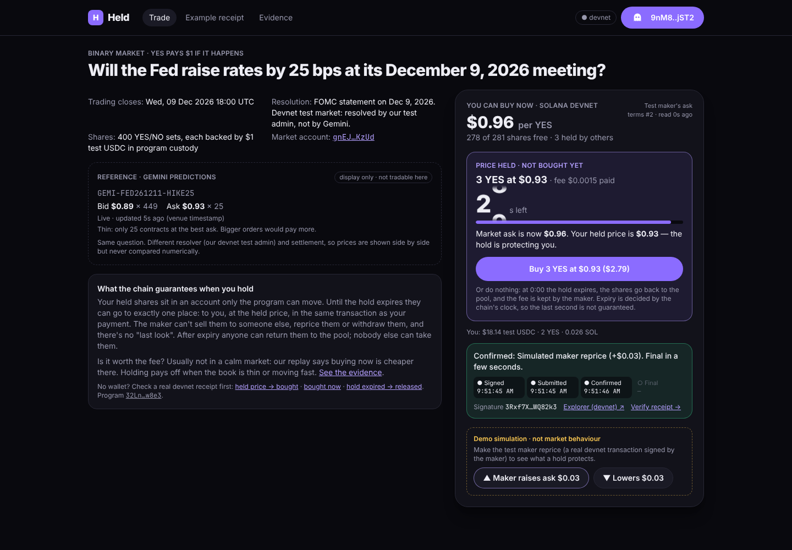
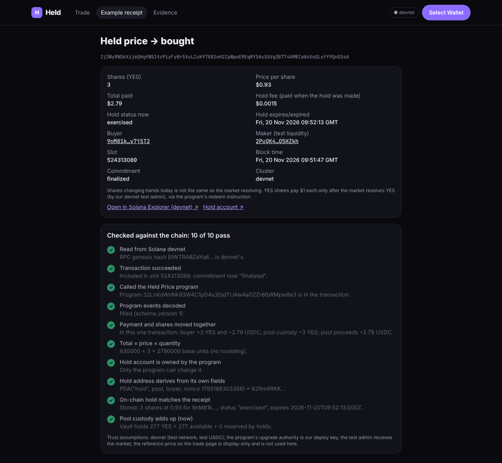
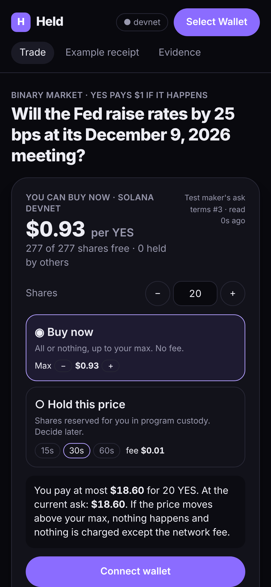

# Held — buy now, or hold the price

**See a price. Keep it while you decide.**

Held is a consumer order ticket for binary outcome shares ("Will the Fed hike 25 bps in December? Buy 20 YES") on **Solana**. You choose between:

- **Buy now** — all-or-nothing at the executable ask, up to your max price. No fee. *(The default.)*
- **Hold this price** — pay a small, disclosed fee and the current ask is frozen for you for 15–60 seconds. The shares are **reserved in program custody**: until expiry they can only go to you, at that price, in the same transaction as your payment. Then buy, or let it expire.

Every action ends in a **receipt anyone can verify** against chain state, no wallet needed.

| Price held while the maker reprices | Receipt checked against chain state | Mobile |
|---|---|---|
|  |  |  |

| | |
|---|---|
| **Track** | Consumer Applications · **Chain award:** Best use of Solana |
| **Program ID (devnet)** | [`32LnKdWnNk93W4C1pD4s3DjdTUAw4aGZZr6tbRMpw8e3`](https://explorer.solana.com/address/32LnKdWnNk93W4C1pD4s3DjdTUAw4aGZZr6tbRMpw8e3?cluster=devnet) |
| **Markets (devnet)** | 4 live markets, each its own on-chain market + maker pool, each mirroring a Gemini Predictions contract (display-only): **Fed hike 25 bps** (Economics) · **BTC ≥ $60k on Nov 27** (Crypto) · **Portland beats New York** (Sports) · **Austin high 76–77°F today** (Weather). Defined in [`contracts/markets.json`](contracts/markets.json); pinned in `frontend/src/deployment.json`. |
| **Try it without a wallet** | Open `/receipt/<signature>` for any example below, or press **"No wallet? Use a demo wallet"** on the trade page. |
| **Example receipts (real devnet txs)** | [held → bought](https://explorer.solana.com/tx/hDLWb3vMbtnToRBeVA1SHgCKTrDVZuLqPUPC4S5S48Bv3bgXmLJabhHTLTk5TYPZ5U1mPwcWewXB9EFuMo78zSc?cluster=devnet) · [bought now](https://explorer.solana.com/tx/68uWKUeu6HU3U2NWzrUMNJ3Ne9FfASLoS7opQUyni9Dy9mYrEjp3Djy64VetH9gygT77DGFC6qgS8TLpTX4BSuv?cluster=devnet) · [hold expired → released](https://explorer.solana.com/tx/4ocHfkzwKFQEfPBbUzcwKBZGNe8wGxs44KiP3kGqkfK82KtiS9uCaH5SLG42ZuLtfLBxh8P7Edzc1woaMbkfUE6Q?cluster=devnet) |

---

## The honest result (read this first)

We started out wanting to sell everyone a "firm quote". **Our own replay overturned that.** On identical, seeded synthetic price paths, a plain atomic buy with a max price beats a priced hold in calm, normal and thin markets; the hold helps only when prices move fast. A fairly priced hold is an option: it moves value between buyer and maker, it doesn't create any. What survives is **fill certainty**: in thin books the hold cut unfilled shares from **1.62 → 0.39 per order**. A real Gemini book we sampled had only 25 contracts at the best ask.

So the app defaults to **Buy now** and offers the hold as an explicitly priced option, at $0.00125/share-minute (≈ the replay's normal-regime break-even of $0.00124; makers should scale it with volatility). Details: [`econ/RESULTS.md`](econ/RESULTS.md) and the in-app **Evidence** page.

## What the chain enforces (the one guarantee)

While a hold is active, its shares sit in a token account owned by the pool PDA. The program lets them leave in exactly two ways:
1. `exercise` — signed by the hold's buyer, before `expires_at`, paying `price × qty` in the **same instruction** that delivers the shares;
2. `release` — callable by **anyone** at/after `expires_at`, which only moves them from `reserved` back to `available` (nothing goes to the caller).

The maker can't sell reserved shares to someone else, withdraw them, reprice them, or "last look". Payments go to a **pool-owned proceeds vault** (the maker claims from it), so the maker can't block exercises by closing their own account. The expiry boundary is non-overlapping (`now < expires_at` exercises, `now >= expires_at` releases).

## How Held uses Solana

| Feature | Where | Why |
|---|---|---|
| Anchor program, 13 instructions | `contracts/programs/held_quote` | market, maker, buyer and permissionless cleanup rules all on-chain |
| PDA custody (pool vault, proceeds vault, market vault) | `pool.rs`, `market.rs` | only program rules move shares or money; no admin key can |
| Fully collateralized outcome shares | `split` / `redeem` | 1 YES + 1 NO minted only against $1 test USDC; winners redeem $1 |
| Atomic delivery (`transfer_checked` ×2 in one instruction) | `trade.rs::deliver` | payment and shares move together or not at all |
| Clock sysvar expiry + permissionless `release` | `trade.rs` | no server needed to end a hold or free inventory |
| Versioned events (`schema_version = 1`) | `events.rs` | receipts are rebuildable from logs by any client |
| Program-owned Hold accounts kept as receipts | `state.rs` | the receipt is chain state, not our database |
| Speed and fees | — | an exercise confirms in about a second for a fraction of a cent, so a 30-second hold is usable |

## Trust assumptions (stated plainly)

- **Devnet only, test assets.** Collateral is a test USDC mint whose mint authority is our faucet key. Outcome shares are devnet test instruments.
- **Resolution is by our test admin**, not by Gemini. So the Gemini reference price is **display-only** and never compared numerically (terms differ).
- **Program upgrade authority** is our deploy key (`BRAtnnAhQ8peQDPkaTtFCYxnNeGqAbBk15zfgZNWFfwf`). A production version would freeze or multisig it.
- **The demo maker is ours.** "Simulate a reprice" in demo mode is labelled as a simulation; it signs the normal `set_terms` with the maker's key and can't touch existing holds.
- **Clock:** expiry uses the cluster's `unix_timestamp`, whole seconds; the UI disables exercise in the last ~1.5 s.
- **Rent:** each hold creates a ~0.0021 SOL account that stays as the on-chain receipt (shown next to the fee).
- **Resolution only after close:** the admin can't resolve while holds could still be live (fixed after the independent review).
- **Demo guard rails:** one hold reserves at most 100 shares; the demo faucet has a global budget; the demo "reprice" button keeps the ask within $0.06 of $0.93. Rate limits are per server instance (a speed bump, not a security boundary).

## Repo layout

```
contracts/
  programs/held_quote/src/   lib.rs · state.rs (units, fee math, boundary fns + unit tests) · errors.rs · events.rs
                             instructions/{market,pool,trade}.rs
  tests/held_quote.ts        23 local-validator integration tests incl. a randomized state machine vs a JS model
  markets.json               the markets to create (question, close time, Gemini reference)
  scripts/                   seed-markets (all markets + pools) · seed-market (first market + example receipts) · set-terms · restock · release-expired (permissionless crank) · export-idl · demo-env
frontend/  (Next.js 15, React 19, Tailwind v4)
  src/components/Ticket.tsx           the order ticket (buy now / hold / exercise / release)
  src/components/HoldCountdown.tsx    React Bits Counter, reduced-motion aware
  src/lib/send.ts                     simulate → sign → submitted → confirmed → finalized, honest "unknown"
  src/lib/receipt.ts                  independent receipt verifier (events × token deltas × Hold account × PDA)
  src/app/api/reference               read-only Gemini book adapter (one fixed host, cached, labelled)
  src/app/receipt/[sig]               wallet-free receipt page
econ/        replay harness, results, chart (seeded synthetic + one labelled Gemini snapshot)
docs/research/   claims ledger · venue map · protocol review · design · skeptic review · second review (code + independent receipt check)
RUNLOG.md    decisions, identifiers, evidence paths
```

## Run it

Prerequisites: Rust, Solana CLI (Agave 4.4.1), Anchor 0.32.1, Node 22, Python 3 (econ only).

```bash
cd contracts && npm install && anchor build
```

```bash
cargo test -p held_quote --lib
```

```bash
solana-test-validator --reset
```

```bash
cd contracts && solana -u localhost program deploy target/deploy/held_quote.so --program-id target/deploy/held_quote-keypair.json && NODE_OPTIONS=--no-experimental-strip-types ANCHOR_PROVIDER_URL=http://127.0.0.1:8899 ANCHOR_WALLET=~/.config/solana/id.json npx ts-mocha -p ./tsconfig.json -t 1000000 --exit tests/held_quote.ts
```

```bash
cd frontend && npm install && cp .env.example .env.local && npm run build && npm start
```

```bash
pip install -r econ/requirements.txt && python3 econ/harness.py && python3 econ/test_fixture.py
```

Devnet set-up (already done for the IDs above): deploy with `solana program deploy … --use-rpc` if TPU is blocked, then `ANCHOR_WALLET=<funded key> npm run seed-market` (writes `frontend/src/deployment.json`), then `npm run demo-env` for the hosting env vars.

## Test results (all ran)

- **Frontend unit tests:** 6/6 (`npm test`) — Gemini order-book size walk (fills, multi-level walks, unfillable remainder, bounds).
- **Rust unit tests:** 5/5 — fee rounding (10,000 random cases, never under-charges, never > 1 unit over), overflow → error, non-overlapping expiry boundary, terms validation.
- **Integration (local validator):** 25/25 — **markets are isolated** (a hold, pool or vault from one market can't be used with another; nothing moves),  atomic buy, price/inventory limits, self-trade, fee math, price frozen across a maker reprice, reserved shares un-withdrawable, non-beneficiary can't exercise, no double exercise, no release after exercise, duplicate nonce rejected, expiry → exercise fails + anyone releases, **two buyers racing for the last share: exactly one wins, loser untouched**, 40-step randomized state machine checked against a model with **conservation of USDC and shares across every account after every step**, resolution refused before close (it would void live holds), one hold capped at 100 shares, short market: holds can't outlast close → after close trading stops, resolve, release, winners redeem $1, losers can't.
- **Multi-market browser run on devnet:** 4 market tabs each read their own on-chain price + live Gemini panel, selection survives reload, buy + hold → reprice → exercise on the Portland market, receipt 10/10.
- **Browser end-to-end on devnet:** demo wallet + faucet, buy now, max-below-ask rejected before signing, hold → simulated reprice → exercise at held price, hold → expire → release, **refresh mid-transaction resumes**, wallet rejection message, 7/7 receipts fully verified from a wallet-less browser, 390 px mobile without overflow, keyboard reaches the primary action.

## Built during the hackathon

All code here was written during UBC 2026 (Nov 2026). The previous concept (Ghost Checkout) remains on `main` and at its original deployment as a rollback.
